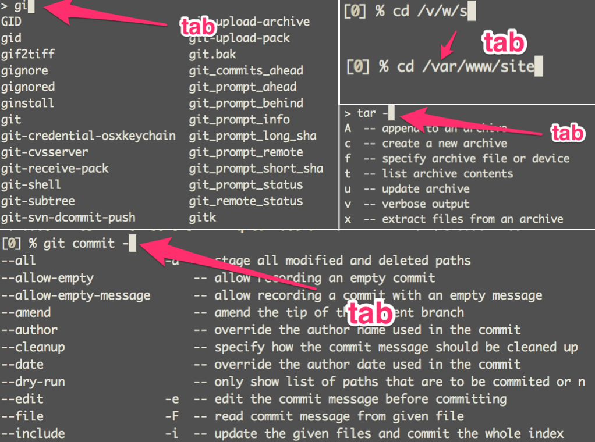
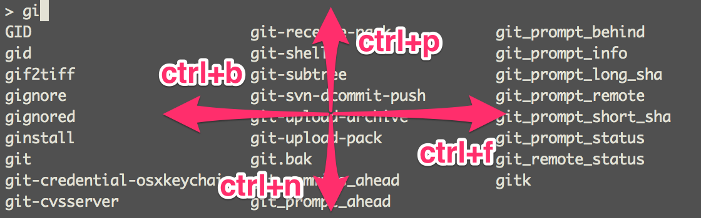
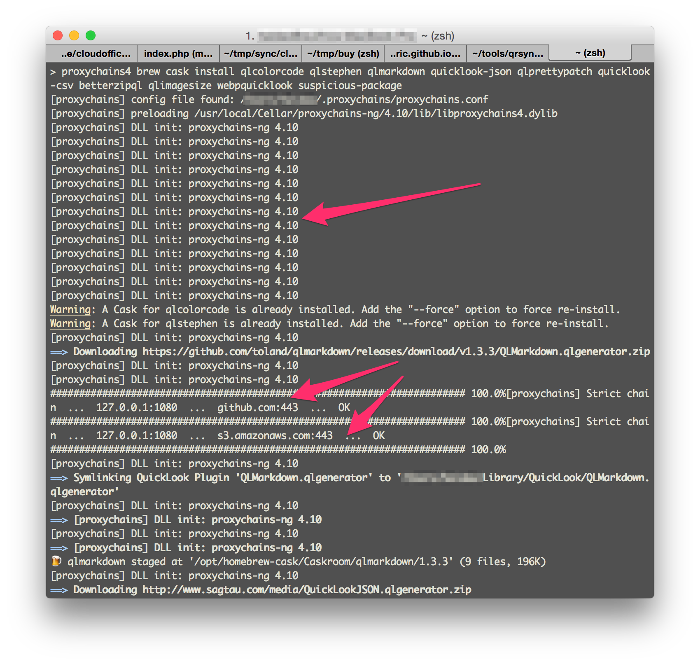
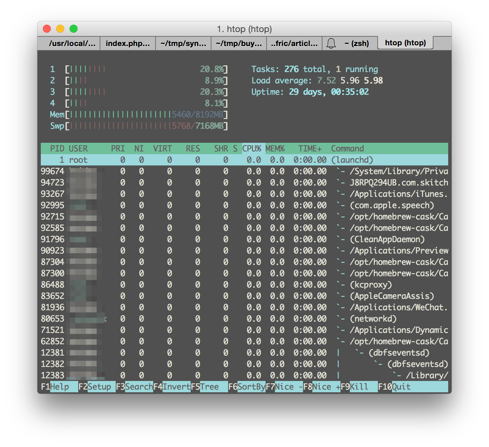
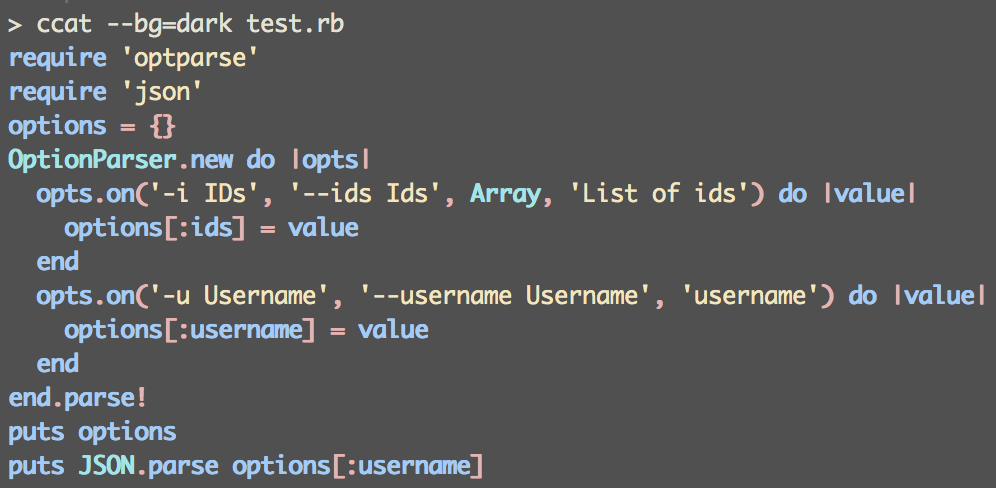

## Zsh

Zsh 也许是目前最好用的 shell，是 bash 替代品中较为优秀的一个。这里列举了 zsh 的一些优点：[为什么要使用 zsh](https://www-s.acm.illinois.edu/workshops/zsh/why.html)。

Mac 自带 zsh，不过我们当然要用最新版啦，其他发行版请参照各自的软件安装方法。安装完毕后，重新打开 iTerm2。

``` bash
brew install zsh
chsh -s `which zsh`
```

### 补全

zsh 的命令补全功能非常强大，可以补齐路径，补齐命令，补齐参数等。（请问你记住 tar 的所有参数了吗😃，只要 `tar -`加 tab 键，再也不用 [rtfm](https://zh.wikipedia.org/zh/RTFM) 了😂）



按下 tab 键显示出所有待选项后，再按一次 tab 键，即进入选择模式，进入选择模式后，按 tab 切向下一个选项，按 shift+tab 键切向上一个选项，ctrl+f/b/n/p 可以向前后左右切换。



以前杀进程是`ps aux | grep xxx`查进程的 PID，然后`kill PID`。有了 zsh，直接`kill xxx`然后按下 tab 键即可～

``` bash
kill emacs
# 按下 tab，变成：
kill 59683
```

### 别名

zsh 不仅支持普通 alias，还支持针对文件类型的 alias。我配置的文件类型 alias 如下：

``` bash
alias -s gz='tar -xzvf'
alias -s tgz='tar -xzvf'
alias -s zip='unzip'
alias -s bz2='tar -xjvf'
alias -s php=vi
alias -s py=vi
alias -s rb=vi
alias -s html=vi
alias gcid="git log | head -1 | awk '{print substr(\$2,1,7)}' | pbcopy"
```

配置完毕之后，在 zsh 下直接输入`xxx.rb`，将自动用 vi 打开，直接输入`xxx.tgz`，将直接按照`tar -xzvf`解压。最后一个`gcid`将当前 git 项目的第一个 commit 的 id 复制到系统剪切板（`pbcopy`是 Mac 下的复制到系统剪切板命令，linux 请参考相应的发行版更改），在执行 rebase 的时候特别方便。

### 跳转

zsh 的目录跳转更为智能，你无需输入`cd`，直接输入路径即可。`..`表示后退一级目录，`../../`表示后退两级，依次类推。（`...`的作用和`../../`相同） 

输入`d`，将列出当前 session 访问过的所有目录，再按提示的数字即可进入相应目录。

``` bash
~
> d
0	~
1	~/Applications
2	~/.proxychains
3	/opt/homebrew-cask/Caskroom

~
> 1
~/Applications
```

### 历史记录

zsh 的历史记录跨 session，可以共享。历史记录支持受限查找。比如，输入`git`，再按向上箭头，会搜索用过的所有 git 命令。

### 通配符搜索

`ls *.png`查找当前目录下所有 png 文件，`ls **/*.png`递归查找。

## oh-my-zsh

[oh-my-zsh](https://github.com/robbyrussell/oh-my-zsh) 是最为流行的 zsh 配置文件，提供了大量的主题和插件，极大的拓展了 zsh 的功能，推动了 zsh 的流行，有点类似于 rails 之于 ruby。

``` bash
# install
# via curl
sh -c "$(curl -fsSL https://raw.github.com/robbyrussell/oh-my-zsh/master/tools/install.sh)"
# via wget 
sh -c "$(wget https://raw.github.com/robbyrussell/oh-my-zsh/master/tools/install.sh -O -)"
```

安装过后，`source ~/.zshrc`使之生效。

### 主题

oh-my-zsh 内置了大量主题，可在`~/.oh-my-zsh/themes`中查看具体的配置。官网提供了一些主题的[截图](https://github.com/robbyrussell/oh-my-zsh/wiki/themes)。也可参见我的[知乎回答](http://www.zhihu.com/question/33277508/answer/58979821)。

``` bash
# 我用的主题是 avit，可以很好的显示 git 信息
/Volumes/Disk Image/cloudoffice  master ✔                                     37m
> 鼠标在新一行
```

### 插件

oh-my-zsh 提供极为丰富的插件，在`~/.oh-my-zsh/plugins`目录下查看具体的配置。在`.zshrc`中写入`plugin(git autojump osx)`即可使用插件，下面介绍几个特别优秀的插件。

#### git

精简 git 命令，减少输入字符数。参见 [Plugin:git](https://github.com/robbyrussell/oh-my-zsh/wiki/Plugin:git)。该插件提供的快捷命令比较多，挑几个常用和好记的记忆即可，不必全记。我常用的有`gst`, `ggp`, `gco`, `gcm`, `gcp` 等。

#### autojump

[autojump](https://github.com/wting/autojump) 按照你的使用频率记录路径，使得目录的跳转更为方便。安装`brew install autojump`。如需跳转到包含 'foo' 的目录，执行`j foo`，这是最基础，也是最常用的命令。除此之外，还有`jc`, `jo`, `jco`命令，查看官网文档获取更多的使用方法。

#### osx

该插件增强 Mac 下的使用体验，提供了如下命令：

- `cdf`: 在 Finder 中打开要 cd 的目录；
- `quick-look`: 快速预览该文件，类似于在 Finder 中按下空格键；
- `man preview`: 在 preview 中打开 man page； 
- `itunes`: 命令行操作 iTunes。

``` bash
> itunes
itunes:shift:2: shift count must be <= $#
Usage: itunes <option>
option:
	launch|play|pause|stop|rewind|resume|quit
	mute|unmute	control volume set
	next|previous	play next or previous track
	shuf|shuffle [on|off|toggle]	Set shuffled playback. Default: toggle. Note: toggle doesn't support the MiniPlayer.
	vol	Set the volume, takes an argument from 0 to 100
	help	show this message and exit
```

其他命令可查看[插件](https://github.com/robbyrussell/oh-my-zsh/blob/master/plugins/osx/osx.plugin.zsh)。

## proxychains

proxychains 是命令行的科学上网工具。安装`brew install proxychains-ng`。如图所示，亚马逊 S3 存储服务和 github 并不稳定，有时候需要科学上网才能访问。

``` bash
# 原命令
brew cask install xxx
# 使用 proxychains
proxychains4 brew cask install xxx
```



使用 proxychains 需要本地先开启科学上网的工具，比如 VPN/shadowsocks，然后在配置文件中添加相应的配置，其配置方法和 chrome 下的科学上网插件很相似，可以参考相关文档。

``` bash
# 在文件 ~/.proxychains/proxychains.conf 的末尾 ProxyList 部分，参照 ProxyList format Examples 添加，比如我用的是 shadowsocks，则配置是：
socks5 	127.0.0.1 1080
```

## 其他

### ag

[ag](https://github.com/ggreer/the_silver_searcher) 是一个新的搜索工具：

- 与`ack`相比，速度有了巨大的提升，这里有一个[对比](http://dongweiming.github.io/blog/archives/ack/)；
- 搜索会忽略`.gitignore`和`.hgignore`中的 pattern；
- 不想搜索的文件可以把对应的 pattern 写到`.agignore`中；
- 命令比`ack`短 33%，且一只手可以按全。

最后一条虽然看似戏谑，却道出了工具的本质：哪怕是能减少输入一个字符，也是必要的进步。

### htop

[htop](http://hisham.hm/htop/) 是一款运行于 Linux 系统监控与进程管理软件，用于取代 Unix 下传统的 top。与 top 只提供最消耗资源的进程列表不同，htop 提供所有进程的列表，并且使用彩色标识出处理器、swap 和内存状态。[^htop-wiki]



htop 命令优点[^htop-lizhenghn]:

- 快速查看关键性能统计数据，如 CPU（多核布局）、内存/交换使用；
- 可以横向或纵向滚动浏览进程列表，以查看所有的进程和完整的命令行；
- 杀掉进程时可以直接选择而不需要输入进程号；
- 通过鼠标操作条目；
- 比 top 启动得更快。

### ccat

[ccat](https://github.com/jingweno/ccat) 是上色的`cat`，在 cat 的基础上提供了语法高亮。可通过`brew install ccat`安装。目前已支持`ruby`, `python`, `javascript`, `java`, `c`, `go`。




[^htop-wiki]: [Htop - 维基百科，自由的百科全书](https://zh.wikipedia.org/wiki/Htop)
[^htop-lizhenghn]: [Linux下超级命令htop的学习使用 - lizhenghn - 博客园](http://www.cnblogs.com/lizhenghn/p/3728610.html)

