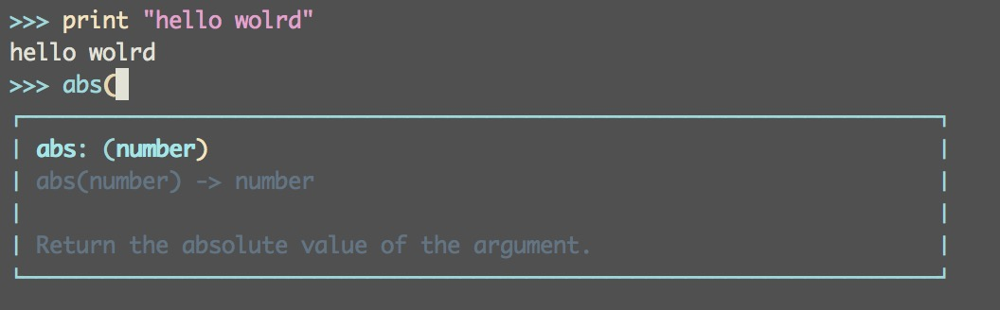
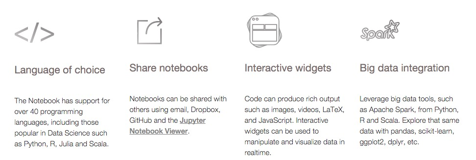
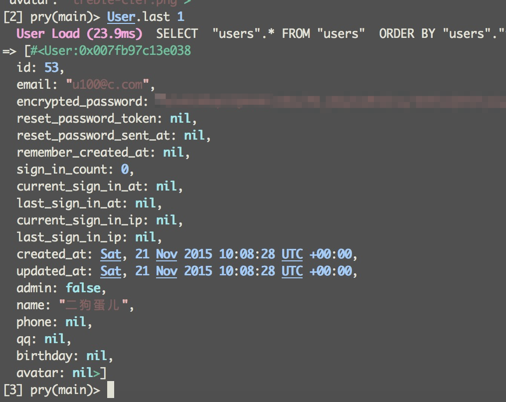

在习惯使用动态语言之后，很是热衷于在 repl 下做各种尝试验证一些简单的想法。多数动态语言都内置提供了 repl，比如 python 的`python`，ruby 的`irb`，php 的`php -a`，nodejs 的`node`，甚至 haskell 这样的静态语言也有 repl: `ghci`。 只是这些自带的 repl 都比较简单，所以会有一些替代工具，提供**更好**的体验：语法高亮，即时输出，简单的代码补全和提示。

### php

php 默认的是`php -a`，功能很差，要输出内容还必须 echo。`boris`是更好的替代，不需输入 echo 直接输出，也有基本的语法高亮（只对输出有高亮，输入没有）。boris 没有代码补全。

MAC 自带的 php 缺乏一些必要的组件，使得 boris 无法使用，建议使用 brew 下的 php: `brew install php`。

```php
[1] boris> class A {
[1]     *> function t(){
[1]     *> return "test";
[1]     *> }
[1]     *> }
// NULL
[2] boris> $a = new A;
// object(A)(
//
// )
[3] boris> $a->t();
// 'test'
```

### python

python 自带的也很难用，但是 python 的替代工具要比 php 多，而且极其强大，强大到可以独立作为一个工具使用，而不仅仅是 python 的 repl。

bpython 是一个相当优秀的替代，不仅提供了很好的高亮，也可以 tab 键智能补全和提示。建议当只是想做一些简单的试验的时候，用 bpython 代替 python。



ipython 的 terminal 看起来似乎没有 bpython 好，不仅没有语法高亮，代码提示也很一般[^2]。但是 ipython 是完全不同的一个工具，详情看[官网](http://ipython.org/)，这是一个套件，支持交互式的数据可视化，ipython notebook 是一个强大的 python IDE，功能很类似 matlab（不妨参考之前的[文章](/2015/10/better-config-for-matplotlib/)）。毕竟，一个可以招博士后的项目，绝非池中之物[^1]。

ipython notebook 基于 [jupyter](http://jupyter.org/)，功能丰富。jupyter 目前已支持 bash, haskell, julia, python, r, ruby, scala。[Try](https://try.jupyter.org/)



最近的 4.1 [更新](http://blog.jupyter.org/2016/01/08/notebook-4-1-release/)中，更是提供了一些现代编辑器如 sublime text 和 atom 的功能，比如 Command palette，以及更强大的查找和替换。详情请查看上面博文。

### ruby

ruby 自带的 irb 默认功能是挺简单的，但是配置好 irbrc 后，也是可以实现常见的高亮和提示功能的。然而在 ruby 世界用 pry 的更多，pry  默认配置已经足够好，还可以配置 pryrc，完全定制 pry 的样式和功能。pry 提供了一些实用[插件](https://github.com/pry/pry/wiki/Available-plugins)，甚至有 [pry-theme](https://github.com/kyrylo/pry-theme) 这样的项目。ruby 世界对颜值的追求一向不落人后。



### nodejs

nodejs 除了自带的 node，也有一些第三方 repl 增强。[nesh](http://danielgtaylor.github.io/nesh/) 就是其中很优秀的一个。不得不说，node 世界最近发展迅速，开发者热情高涨，插件、库层出不穷。[nesh plugins](https://www.npmjs.com/browse/keyword/nesh)


```bash
npm install -g nesh
# Run nesh
nesh
# Run nesh with CoffeeScript
nesh -c
# Run nesh with ES6 through Babel
nesh -b
```

[i.js](https://github.com/mksenzov/i.js/tree/master) 是一个受 ipython 启发而开发的项目，但不是基于 jupyter。有兴趣的不妨尝试一下。


### others

然而在 Linux 世界，还有很多命令行工具极其简陋，比如 sqlite3，比如 ftp，连基本的向上方向键查看命令历史的功能都没有提供，一时也没有好的替代，应该怎么办呢？

[rlwrap](https://github.com/hanslub42/rlwrap) 正是解决这一问题的工具。

```bash
[0] % sqlite3 production.sqlite3
SQLite version 3.8.4.1 2014-03-11 15:27:36
Enter ".help" for usage hints.
sqlite> .tables
albums             images             users
articles           schema_migrations
sqlite> ^[[A^[[A^[[A^[[A
```

```bash
[1] % rlwrap sqlite3 production.sqlite3
SQLite version 3.8.4.1 2014-03-11 15:27:36
Enter ".help" for usage hints.
sqlite> .tables
albums             images             users
articles           schema_migrations
sqlite> .tables
```

使用 rlwrap，方向键可用了。

[^1]: IPython/Jupyter is hiring postdocs: the project has [two postdoctoral positions open at UC Berkeley](http://blog.jupyter.org/2015/11/19/project-jupyter-is-hiring-two-postdoctoral-fellows-uc-berkeley)

[^2]: 因为 ipython terminal 还不是很好用，因此有了这个项目 [bipython](http://bipython.org/)。尽管个人觉得不是很必要😳