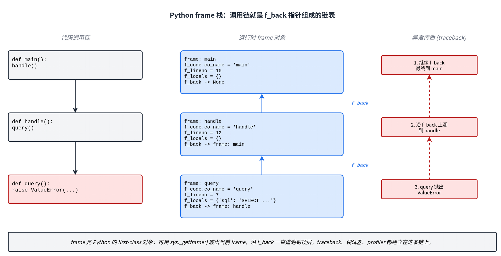

Python 提供了几套观测程序运行时行为的接口：`sys.settrace`、`sys.monitoring`、`greenlet.settrace`、asyncio Task API。它们都用来追踪正在执行的代码，但作用对象处于不同层次，触发的事件和能回答的问题也不一样。这篇文章按 frame -> code object -> greenlet -> Task 的顺序，把这四条边界看到什么、看不到什么逐个讲清楚：

- CPython frame：`sys.settrace` 的根基
- code object 事件：`sys.monitoring` 在 3.12 后的低成本接口
- greenlet 调度：gevent 在 frame 之外切换的额外一层
- asyncio Task：event loop 内部多个协程的身份归属

---

## 1. frame：Python 层的栈帧

frame 是 Python 层的栈帧。CPython 每调用一次 Python 函数，就给这次调用造一个对象，记录正在跑哪段代码、局部变量是什么、下一条字节码在哪里、上一层调用者是谁。这个对象在 Python 层就是 frame，可以用 `sys._getframe()` 取出来。

下面这段代码沿 `f_back` 往上一层层取：

```python
import sys

def query():
    f = sys._getframe()
    while f is not None:
        print(f"{f.f_code.co_name:>10}  line {f.f_lineno:>3}  {f.f_code.co_filename.split('/')[-1]}")
        f = f.f_back

def handle():
    query()

def main():
    handle()

main()
```

实际输出：

```text
     query  line   6  demo_frame.py
    handle  line  10  demo_frame.py
      main  line  13  demo_frame.py
  <module>  line  15  demo_frame.py
```

调用链「`main -> handle -> query`」在 frame 链表里就是「query.f_back = handle frame, handle.f_back = main frame, main.f_back = `<module>` frame」。frame 几个常用字段：

- `f_code` -- 正在执行的 code object，里面装着函数名、文件名、字节码。调试器靠它定位「在哪个函数里」。
- `f_locals` -- 当前局部变量。`pdb` 让你在断点上看变量、改变量，就是读改它。
- `f_globals` -- 模块层变量。
- `f_lineno` -- 当前源码行号。coverage 沿这一条信息记录「这一行跑过」。
- `f_back` -- 上一层 frame。异常 traceback 沿这条指针展开。

把这件事画出来就是这张图：



frame 是 first-class 对象，任何代码都能读它的字段，也能改写 `f_locals` 这类字段。但 `sys._getframe()` 要在代码里调用方主动取；如果想让解释器在每个 frame 边界自动通知外部工具，需要换一个接口。

---

## 2. sys.settrace：解释器层的 trace 钩子

`sys.settrace(tracefunc)` 给当前线程装一个 trace function。新作用域进入时触发 `call`；trace function 返回的本地 trace function 会继续接收 `line`、`return`、`exception`。[^sys-settrace]

一段最小追踪器：

```python
import sys

def trace(frame, event, arg):
    name = frame.f_code.co_name
    if name in ("query", "handle", "main"):
        if event == "call":
            print(f"  call    {name}")
        elif event == "line":
            print(f"  line    {name}:{frame.f_lineno}")
        elif event == "return":
            print(f"  return  {name}")
    return trace

def query():
    x = 1
    return x

def handle():
    return query()

def main():
    return handle()

sys.settrace(trace)
main()
sys.settrace(None)
```

跑一次的输出：

```text
  call    main
  line    main:22
  call    handle
  line    handle:19
  call    query
  line    query:15
  line    query:16
  return  query
  return  handle
  return  main
```

事件按顺序展开就是「main 入 -> 跑到第 22 行 -> 调 handle -> handle 跑到第 19 行 -> 调 query -> ...」。frame 的进入、离开、每一行执行都按顺序触发了出来。

有几条值得提前知道的性质：

- `sys.settrace` 是线程相关的，只影响当前线程。多线程要么各自设，要么用 `threading.settrace()`。[^threading-trace]
- trace function 必须 `return trace` 才能在这个 frame 里继续拿到 `line` 事件。返回 `None` 就只剩 `call`。
- 只有 Python frame 触发事件。C 函数（包括 C 扩展里的调用）不会产生 `call` / `line`，所以 debugger 和 coverage 都看不到 C 实现的函数内部。

回调频率是它最大的成本来源。一个直观的测量：

```python
import sys, time

def noop(*a):
    return noop

def loop():
    for _ in range(1_000_000):
        pass

t0 = time.perf_counter(); loop(); base = time.perf_counter() - t0
sys.settrace(noop); t0 = time.perf_counter(); loop(); sys.settrace(None)
traced = time.perf_counter() - t0
print(f"baseline {base*1000:.1f} ms, traced {traced*1000:.1f} ms, slowdown {traced/base:.1f}x")
```

在 Python 3.12 / x86_64 上的一次实测：

```text
baseline 6.1 ms, traced 81.9 ms, slowdown 13.5x
```

`return noop` 这种最简单的 trace 也会把 tight loop 拖慢一个数量级。调试器和 coverage 能接受这种代价，长时间在线的 profiler 不行。`sys.monitoring` 就是为这种场景设计的。

---

## 3. sys.monitoring：低开销的事件接口

Python 3.12 加入了 `sys.monitoring`。PEP 669 的目标是把调试器、覆盖率、profiler 的常态成本降下来。[^sys-monitoring][^pep-669]

它和 `sys.settrace` 的差别在于：`settrace` 每个事件都要走一遍 Python 回调，`monitoring` 让你按 code object 注册、按事件类型订阅，并能在单点 `DISABLE` 后续触发，未订阅的代码路径接近零成本。一个最小例子：

```python
import sys

mon = sys.monitoring
tool_id = mon.PROFILER_ID
events = mon.events

mon.use_tool_id(tool_id, "demo-profiler")

def on_start(code, instruction_offset):
    print("start", code.co_name, instruction_offset)

mon.register_callback(tool_id, events.PY_START, on_start)
mon.set_events(tool_id, events.PY_START)
```

后文会用到的几个事件：

- `PY_START` / `PY_RETURN` -- Python 函数开始 / 返回
- `PY_YIELD` / `PY_RESUME` -- generator、coroutine 暂停 / 恢复（PEP 669 显式定义[^sys-monitoring]）
- `LINE` -- 即将执行新行
- `RAISE` -- 抛异常

其他事件（`CALL`、`INSTRUCTION`、`JUMP`、`BRANCH`、`EXCEPTION_HANDLED`、`PY_UNWIND` 等）见官方文档。[^sys-monitoring]

`monitoring` 解决的是「插桩成本」，不是「插桩位置」。它和 `sys.settrace` 一样站在 CPython frame / code object 这一层；如果 frame 之上还有另一层调度，这些事件就看不到调度边。

---

## 4. gevent 下 sys.settrace 的失效

greenlet 是 gevent 的基础。每个 greenlet 拥有自己独立的一段 C 栈和一串 Python frame；gevent 在 Hub 里按 IO/超时调度，让它们在同一个 OS 线程里轮流跑。[^gevent-intro][^greenlet-concepts]

greenlet 的 switch 实现在自己的 C/汇编代码里。源码里 greenlet 被描述成「a range of C stack addresses that must be saved and restored」，切换时直接 `memcpy` 在堆和栈之间拷贝[^greenlet-source]；不同架构对应一份汇编（`switch_amd64_unix.h` 等）执行寄存器和栈指针的转移。**CPython 没有为这次 switch 定义任何 trace 或 monitoring 事件**。frame 事件本身还在，只是事件之间缺一条「这里发生了一次切换」的标记。

用一段代码看：

```python
import sys
import gevent

def trace(frame, event, arg):
    name = frame.f_code.co_name
    if name == "task" and event in ("call", "return"):
        print(f"  [trace] {event:6}  task ({frame.f_locals.get('name', '?')})")
    return trace

def task(name):
    print(f"--> {name} start")
    gevent.sleep(0)
    print(f"--> {name} done")

sys.settrace(trace)
gevent.joinall([gevent.spawn(task, "A"), gevent.spawn(task, "B")])
sys.settrace(None)
```

实际输出：

```text
  [trace] call    task (A)
--> A start
  [trace] call    task (B)
--> B start
--> A done
  [trace] return  task (A)
--> B done
  [trace] return  task (B)
```

事件顺序是 call A -> call B -> return A -> return B：A 还没 return，B 就已经 call 进来了。沿 `sys.settrace` 在线程上维护调用栈，会把 A 和 B 的执行交叠成一团。gevent 下常说的「`sys.settrace` 失效」就是这个意思 -- 事件没丢，但事件归属没法只用 frame 还原。

把事件流和真实归属画在同一张时间轴上：


切换发生在汇编层的栈拷贝里，没有任何 Python frame 在那一刻进入或退出。所以 `sys.settrace` 不会触发事件，`sys.monitoring` 也不会有 `PY_YIELD` / `PY_RESUME`（这两个事件只在 CPython 自己实现的 generator / coroutine 暂停点触发）。

greenlet 自己提供了这个接口。`greenlet.settrace(callback)` 安装一个 hook，每次 switch 都把 `(origin, target)` 传给回调。[^greenlet-tracing]两个事件：

- `switch` -- 普通切换
- `throw` -- 通过 `greenlet.throw()` 切到目标并抛异常

把它和 `sys.settrace` 串起来用：

```python
import sys, gevent, greenlet

def label(g):
    if isinstance(g, gevent.Greenlet) and g._run and g.args:
        return f"{g._run.__name__}({g.args[0]})"
    return type(g).__name__

def py_trace(frame, event, arg):
    if frame.f_code.co_name == "task" and event in ("call", "return"):
        print(f"  [py] {event:6}  task({frame.f_locals.get('name', '?')})")
    return py_trace

def gl_trace(event, args):
    if event == "switch":
        origin, target = args
        print(f"  [gl] switch  {label(origin)} -> {label(target)}")

def task(name):
    print(f"--> {name} start")
    gevent.sleep(0)
    print(f"--> {name} done")

greenlet.settrace(gl_trace)
sys.settrace(py_trace)
gevent.joinall([gevent.spawn(task, "A"), gevent.spawn(task, "B")])
```

输出（截取主要部分）：

```text
  [gl] switch  greenlet -> Hub
  [gl] switch  Hub -> task(A)
  [py] call    task(A)
--> A start
  [gl] switch  task(A) -> Hub
  [gl] switch  Hub -> task(B)
  [py] call    task(B)
--> B start
  [gl] switch  task(B) -> Hub
  [gl] switch  Hub -> task(A)
--> A done
  [py] return  task(A)
  [gl] switch  Greenlet -> Hub
  [gl] switch  Hub -> task(B)
--> B done
  [py] return  task(B)
```

读这条流：先切到 task(A)，A 跑到 sleep 后切回 Hub，Hub 又切到 task(B)，B 跑到 sleep 后再切回 Hub，最后切回去依次让 A 和 B 跑完。每个 `[py] call/return` 都对应一段连续的 greenlet 时间窗口，事件归属重新清晰。

gevent 自己的监控也走这条边：监控线程靠 `greenlet.settrace` 拿到 switch 时间戳来判断 event loop 被阻塞，所以业务代码自己装 trace 时如果没把前一个 trace 串起来，gevent 的监控会跟着失效。[^gevent-monitoring]

---

## 5. asyncio 的暂停发生在字节码层

asyncio 也是协作式并发，默认也在一个线程里跑很多协程。但它的调度切换发生在不同的层。

CPython 文档明确指出，generator 和 coroutine 的暂停是字节码实现的：「This is implemented by the YIELD_VALUE bytecode...」「A yield from expression ... is implemented with the SEND instruction.」[^cpython-generators] `RESUME` 指令在「After an await expression」位置标记恢复点[^dis-resume]。这些指令是 CPython 自己的，sys.monitoring 把它们暴露成 `PY_YIELD` 和 `PY_RESUME` 事件[^sys-monitoring]。所以 asyncio 协程的每一次暂停和恢复，对 CPython 来说都是可见的。

这导致 trace 工具看到的内容也不一样：

| | gevent | asyncio |
|---|---|---|
| 调度切换位置 | C/汇编层（`slp_switch`） | 字节码层（`YIELD_VALUE` / `SEND` / `RESUME`） |
| CPython 是否感知 | 不感知 | 感知（`PY_YIELD` / `PY_RESUME`） |
| `sys.settrace` 看到的栈 | 错乱交叠 | 干净的协程栈 |
| 需要额外接口标记调度边 | 需要 `greenlet.settrace` | 不需要 |
| 协程暂停时 frame | 整段 C 栈被拷走 | frame 仍在，`gen_frame_state = SUSPENDED` |

第二张图把这种分层差异画出来：


asyncio 缺的不是 frame 完整性，是 **Task 身份**。事件本身正确，问题是工具需要把每次 frame 事件归到「哪个 Task」名下。`asyncio.current_task()` 就够用：

```python
import sys, asyncio

def py_trace(frame, event, arg):
    if frame.f_code.co_name == "task" and event in ("call", "return"):
        task = asyncio.current_task()
        tag = task.get_name() if task else "-"
        print(f"  [py:{tag}] {event:6}  task({frame.f_locals.get('name', '?')})")
    return py_trace

async def task(name):
    print(f"--> {name} start")
    await asyncio.sleep(0)
    print(f"--> {name} done")

async def main():
    sys.settrace(py_trace)
    await asyncio.gather(
        asyncio.create_task(task("A"), name="A"),
        asyncio.create_task(task("B"), name="B"),
    )
    sys.settrace(None)

asyncio.run(main())
```

输出：

```text
  [py:A] call    task(A)
--> A start
  [py:A] return  task(A)
  [py:B] call    task(B)
--> B start
  [py:B] return  task(B)
  [py:A] call    task(A)
--> A done
  [py:A] return  task(A)
  [py:B] call    task(B)
--> B done
  [py:B] return  task(B)
```

`await` 那一刻被解释器当成 PY_YIELD（在 `sys.settrace` 接口下表现为 `return`），resume 时再触发一次 `call`。事件数比 gevent 例子还多一倍，但 `current_task()` 始终给出正确归属，每条事件前面都有清楚的 Task 标签，整段事件流不会出现归属错位。

如果还需要更多上下文，标准库提供了：

- `asyncio.all_tasks()` 列出 loop 里所有未完成 Task
- `Task.get_stack()` / `Task.print_stack()` 看挂起 Task 的当前栈
- `Task.get_coro()` 拿到底层 coroutine
- `Task.get_context()` 取 Task 绑定的 `contextvars.Context`[^asyncio-task]

asyncio 里另一层常用的工具是 `contextvars`。请求 ID、trace ID 这种逻辑上下文放线程局部变量会在 Task 之间互相污染，ContextVar 沿 Task 上下文传播，刚好对应 asyncio 的并发单位。[^contextvars]

---

## 6. 四种接口的对照

| 接口 | 站在哪个边界 | 看到的 | 看不到的 | 典型用途 |
|---|---|---|---|---|
| `sys.settrace` | CPython frame | call / line / return / exception | greenlet switch、asyncio Task 身份、C 函数 | debugger、coverage、教学工具 |
| `sys.monitoring` | code object 事件 | `PY_START` / `PY_RETURN` / `PY_YIELD` / `PY_RESUME` / `LINE` / `RAISE` 等 | 同上，但常态成本更低 | profiler、低开销 coverage |
| `greenlet.settrace` | greenlet 调度边 | switch、throw 及 `(origin, target)` | frame 内部细节 | gevent 请求归属、阻塞检测 |
| asyncio Task API | coroutine 调度身份 | `current_task` / `all_tasks` / `Task.get_stack` 等 | frame 事件本身 | asyncio 请求归属、挂起诊断 |

接口和接口之间不是替代关系。在 gevent 应用里做请求级 profiler，frame 事件来自 `sys.settrace` 或 `sys.monitoring`，调度边来自 `greenlet.settrace`，运行时状态来自 gevent 自带的 monitor thread 和 `gevent.util.print_run_info()`。在 asyncio 应用里换成 frame 事件加 `asyncio.current_task()` 加 `contextvars`。

把「线程」当作唯一执行上下文，在纯线程模型里基本够用；遇到 gevent 或 asyncio，一个 OS 线程里同时跑着多条逻辑执行流，单看 frame 事件容易把它们的调用栈混在一起。这时要按观测对象选接口：追请求归属，接 `greenlet.settrace` 或 `asyncio.current_task()`；查阻塞，用 gevent monitor thread 或 `Task.get_stack()`。

---

[^sys-settrace]: Python 文档：`sys.settrace()`，<https://docs.python.org/3/library/sys.html#sys.settrace>
[^threading-trace]: Python 文档：`threading.settrace()` / `threading.settrace_all_threads()`，<https://docs.python.org/3/library/threading.html#threading.settrace>
[^sys-monitoring]: Python 文档：`sys.monitoring`，<https://docs.python.org/3/library/sys.monitoring.html>。`PY_RESUME` 定义："Resumption of a Python function (for generator and coroutine functions), except for throw() calls."；`PY_YIELD`："Yield from a Python function (occurs immediately before the yield..."
[^pep-669]: PEP 669: Low Impact Monitoring for CPython，<https://peps.python.org/pep-0669/>
[^gevent-intro]: gevent 文档：Introduction，<https://docs.gevent.org/intro.html>
[^greenlet-concepts]: greenlet 文档：greenlet Concepts，<https://greenlet.readthedocs.io/en/latest/greenlet.html>
[^greenlet-source]: greenlet 源码：`src/greenlet/greenlet.cpp` 注释「A PyGreenlet is a range of C stack addresses that must be saved and restored」；栈拷贝实现见 `src/greenlet/TStackState.cpp`；汇编切换见 `src/greenlet/platform/switch_amd64_unix.h`。
[^greenlet-tracing]: greenlet 文档：Tracing And Profiling，<https://greenlet.readthedocs.io/en/stable/tracing.html>
[^gevent-monitoring]: gevent 文档：Monitoring and Debugging gevent Applications，<https://www.gevent.org/monitoring.html>
[^cpython-generators]: CPython InternalDocs：generators，<https://github.com/python/cpython/blob/main/InternalDocs/generators.md>
[^dis-resume]: Python 文档：`dis` 模块，`RESUME (context)` 与 context = 3 (After an await expression)，<https://docs.python.org/3/library/dis.html#opcode-RESUME>
[^asyncio-task]: Python 文档：Coroutines and Tasks，<https://docs.python.org/3/library/asyncio-task.html>
[^contextvars]: Python 文档：`contextvars`，<https://docs.python.org/3/library/contextvars.html>
