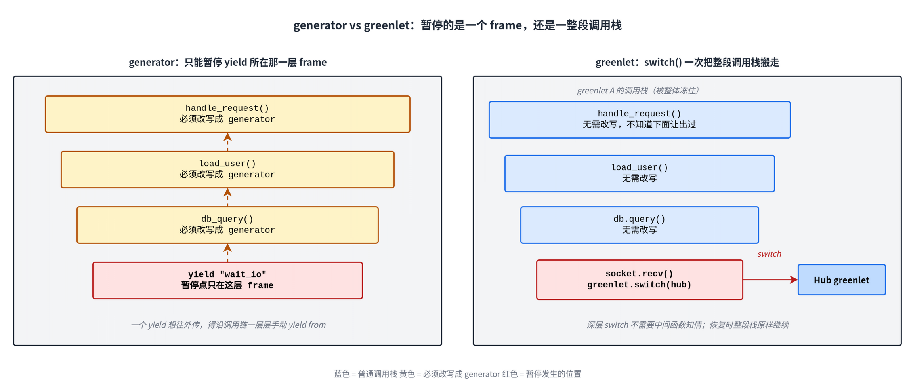
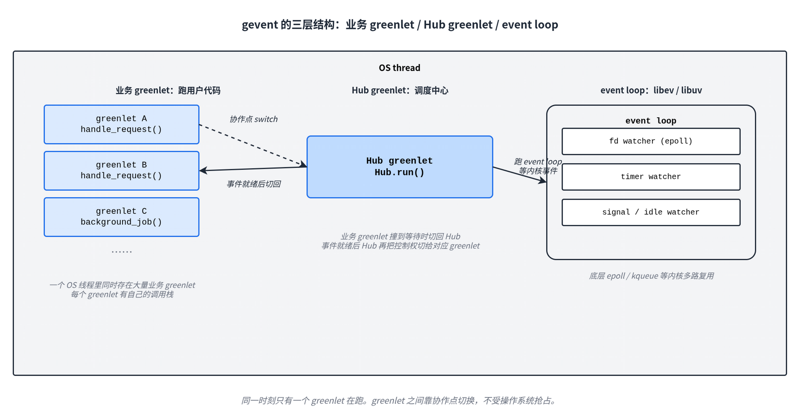
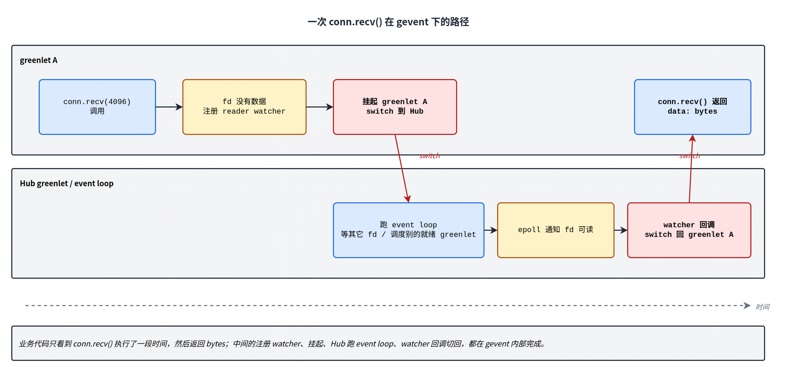

协程可以粗略理解成「能暂停、过会儿再恢复的函数执行流」。一个函数执行到一半让出 CPU，保存住自己的现场，等外部事件来了再恢复，继续从刚才的位置往下跑，这就是协程。

Python 里最常见的两个协程库是 asyncio 和 gevent。asyncio 用 `async`/`await` 语法把暂停点写进代码，协程由事件循环调度，暂停和恢复发生在 Python 字节码层。gevent 走的是另一条路：它对外保留同步 API 的外观，底层用 greenlet 保存一整段调用栈，再用一个特殊的 Hub greenlet 跑 event loop 做调度。这条技术路线可以画成这样：

```text
Python yield / generator
  → 函数可以在 yield 处暂停
greenlet
  → 暂停的不是一个函数，而是一整段调用栈
gevent Hub
  → 用一个特殊 greenlet 跑 event loop，统一调度
cooperative I/O
  → 等 socket / sleep / Event 时切回 Hub
monkey patch
  → 让标准库的同步 API 变成上面这套协作式 API
```

每一步都是上一步不够用之后才走出来的。下面顺着这条路走一遍。

## 1. 同步外观，协作内核

gevent 没有引入新写法。它不要求你写 `async def`，也不要求在等待点写 `await`。业务代码看起来还是普通同步代码：

```python
def handle(conn):
    data = conn.recv(4096)
    return process(data)
```

conn 是普通 socket 时，`recv()` 没数据会让当前 OS 线程睡过去，整个线程要等内核唤醒。conn 是 gevent socket 时，写法不变，但语义换了：没数据时阻塞的是当前 greenlet，不是整个 OS 线程。greenlet 挂起以后，执行权交给 gevent 的 Hub，Hub 在同一个 OS 线程里调度别的 greenlet，等内核事件回来再切回原 greenlet。

这样大量同步写法的代码不用改就能拿到高并发 I/O。但源码表面长得一样、运行时语义完全不同，读 gevent 程序时得经常多想一想：当前这个对象是不是已经被 gevent 接管了。

asyncio 走的是另一条路。它把暂停点写进语法：`data = await reader.read(4096)`，读到 `await` 就知道这里会让出。gevent 把暂停点藏在被替换后的同步 API 里——`data = sock.recv(4096)` 是 OS 线程阻塞还是 greenlet 协作式等待，要看 sock 是什么、socket 模块有没有被 monkey patch。

## 2. yield：让一个函数能暂停

普通函数调用很直接：进入函数体，遇到 `return` 就把局部状态扔掉、把结果交给调用者。下次再调是另起一个调用，局部变量全部重新创建。

函数体里只要出现 `yield`，Python 就会把它编译成 generator function。调用这种函数不会立刻执行函数体，而是返回一个 generator object；每次 `next()` 才向前推一段，直到撞到下一个 `yield` 停下。官方文档把 generator 描述成 resumable function：函数在 `yield` 处暂停，保留执行现场，下次从原位置继续。[^python-generators]

```python
def numbers():
    print("start")
    yield 1
    print("middle")
    yield 2
    print("end")


gen = numbers()
next(gen)   # 打印 start，停在第一个 yield
next(gen)   # 从第一个 yield 后面继续，打印 middle，停在第二个 yield
```

yield 保留下来的东西不止这些：不只是「下一条要执行哪条字节码」，还有当时的局部变量、异常处理状态、对外层 frame 的引用——整次函数调用的现场都还在。generator 不是「记住一个返回值」，是「把整个函数冻起来放一边」，调用者用 `next()` 把它唤醒一段，它再冻起来。

yield 有两个绕不开的边界。一是暂停点必须显式写在函数里，外面没法强行打断它。二是 yield 只暂停 generator 自己那一层 frame，对调用它的函数没有效果——yield 把控制权交给的是直接调用者，不是更上层的人。

最底下的 `db_query` 想在等待 I/O 时让出，假如直接这么写：

```python
def db_query(sql):
    yield "wait_io"
    return fetch_result()

def load_user(uid):
    return db_query("...")   # 普通调用，没法把下层的 yield 传出来
```

`load_user` 调 `db_query` 看上去是普通函数调用，实际上拿到的是一个 generator object，根本没执行。要让暂停从底下传到顶上，`load_user` 也得改：

```python
def load_user(uid):
    result = yield from db_query("...")
    return result
```

外层 `handle_request` 同理，再外层 web 框架的入口同理。最底下一个 `db_query` 想 yield，整条调用链上的函数都得跟着改写成 generator——要么用 `yield from`，要么用 asyncio 后来做出来的 `await` 语法。

asyncio 走的就是这条路：把 yield 做成语言原语。gevent 要的是另一个效果：

```python
def handle_request(request):
    user = load_user(request.user_id)
    return render_profile(user)
```

最底下的阻塞点即使藏在很深的调用里，也能直接让出；恢复以后回到原调用点接着跑、一路返回；调用链中间的函数完全不知道下面发生过让出。这要求暂停的不是一个 frame 而是一整段调用栈，generator 给不了。

## 3. greenlet：把整段调用栈搬走

greenlet 的官方文档把它称作 small, independent pseudo-thread，也可以理解成一段能搬来搬去的 frame 栈。greenlet 创建时分配自己的栈空间，第一次 `switch()` 到它就开始跑入口函数；中间可以再 `switch()` 出去；下次切回来时，从上次暂停的位置继续。[^greenlet-concepts]

最小的两段栈互切：

```python
from greenlet import greenlet


def task_a():
    print("A: before")
    gr_b.switch()
    print("A: after")


def task_b():
    print("B: running")
    gr_a.switch()


gr_a = greenlet(task_a)
gr_b = greenlet(task_b)
gr_a.switch()
```

输出是 `A: before` → `B: running` → `A: after`。`task_a` 里的 `switch()` 不像 `return`，它没让函数结束，只是把当前栈整体冻起来放一边，下次切回来再接着走。

generator 和 greenlet 的区别如图：



放到真实场景里。一个 greenlet 里跑业务代码，调用链一路下去：

```text
handle_request()
  load_user()
    db.query()
      socket.recv()      ← 这里 switch 出去
```

`socket.recv()` 内部 switch 到 Hub 时，从 `socket.recv()` 一直到 `handle_request()` 这一整段 frame 没有被销毁，只是被冻住。Hub 跑别的事，事件就绪后再切回来，`socket.recv()` 接着返回，沿着 db.query → load_user → handle_request 一路正常返回。调用链中间对深层的 switch 是无感知的，外面看起来就是普通同步函数，没有 yield from 或 async/await 的污染。

greenlet 不是 OS 线程。一个 OS 线程同一时刻只有一个 greenlet 在跑，greenlet 文档把它叫 current greenlet，用 `greenlet.getcurrent()` 拿到；要别的 greenlet 跑必须显式 `switch()` 过去。[^greenlet-current]切换是手动的，没人替你抢占。

greenlet 只解决「一个线程里保存多组调用栈、手动在它们之间切」这一件事。什么时候切、谁去等 socket 可读、谁负责把对应的 greenlet 恢复，都不是 greenlet 自己回答的——这是 gevent Hub 干的事。

## 4. Hub 和 event loop

gevent 文档对自己的定义一句话：基于 coroutine 的 Python 网络库，使用 greenlet，在 libev 或 libuv event loop 之上提供高层同步 API。[^gevent-intro]分开看是三层：



一个 OS 线程里同时存在很多业务 greenlet 和一个 Hub greenlet。`gevent.spawn(handle_request, req)` 创建一个新的业务 greenlet 登记到调度系统里，但不会立刻跑——要等当前 greenlet 让出，Hub 才有机会切到它。

业务 greenlet 撞到需要等待的事——等 socket 可读、等 timer 到期、等别的 greenlet 释放锁——就切回 Hub。Hub 跑 event loop，在底层 libev/libuv 上注册 watcher，等 epoll 之类的内核事件。事件就绪后 Hub 再把控制权切给对应的业务 greenlet。

这不是抢占式调度。一个 greenlet 一直跑 CPU 密集的 Python 代码，不调任何 gevent 协作 API、也不主动 `gevent.sleep(0)`，同线程里其它 greenlet 永远轮不到。gevent 适合 I/O 并发，不适合让 CPU 密集的 Python 代码并行——并发优势完全建立在「大家都在等」上。

## 5. 一次 socket.recv() 的路径

把上面的模型放进一个具体调用。业务代码是开头那段，conn 是 gevent socket，fd 上当前没有数据：



`conn.recv()` 内部发现读不到数据，在 event loop 上注册一个 fd 可读 watcher，挂起当前 greenlet，`switch()` 到 Hub。Hub 这边继续跑 event loop——可能在等其它 fd，也可能正好有别的就绪的业务 greenlet 可以调度。某一时刻 epoll 报告 fd 可读，Hub 在 watcher 回调里把对应的 greenlet 重新调度起来，原来的 `conn.recv()` 接着返回数据。

业务代码这边看到的只是 `data = conn.recv(4096)` 跑了一段时间，然后返回 bytes。注册 watcher、挂起 greenlet、跑 event loop、Hub 切回来，全在 gevent 内部消化掉。

「阻塞」这个词在 gevent 里要分清。普通 socket 的阻塞是 OS 线程阻塞，整个线程在内核态睡过去；gevent socket 的阻塞只是当前 greenlet 阻塞，OS 线程并没有睡——它切到了 Hub，Hub 接着等其它 fd 或跑别的就绪 greenlet。一个 gevent 进程能用同步写法撑大量并发连接也是因为这个：每个连接一个 greenlet，业务代码看起来像一条直线；等 I/O 时 greenlet 把执行权交回 Hub。

## 6. monkey patch：把标准库接进协作式调度

greenlet 提供调用栈级别的暂停，Hub 拿 event loop 调度它们，gevent 的内核就齐了。剩下一个工程问题——业务代码里用的是 `socket.socket`、`time.sleep`、`threading.Event` 这些标准库 API，它们不会自己变成协作式。每个 gevent 程序都把 `import socket` 改成 `from gevent import socket`、`time.sleep` 改成 `gevent.sleep`，gevent 的适用范围其实很窄：依赖标准库的第三方代码全都用不上。

monkey patch 就是为这一步存在的。入口很短：

```python
from gevent import monkey
monkey.patch_all()
```

gevent 文档建议把这两行放在程序生命周期最早的位置，最好在主模块开头比所有其它 import 都早，并且要在程序还是单线程时完成。[^gevent-monkey]它替换的是模块属性——`socket.socket`、`time.sleep`、`threading.Event` 这些名字背后的对象会被换成 gevent 的 cooperative 版本；已经从模块 import 出来留在局部的引用，patch 不到。

patch 之后，下面这段平凡的代码：

```python
import socket

sock = socket.socket()
sock.connect(("example.com", 80))
sock.sendall(b"GET / HTTP/1.0\r\n\r\n")
data = sock.recv(4096)
```

每一个会阻塞的调用都走到第 5 节那条路径：注册 watcher、挂起 greenlet、切到 Hub。`socket.socket` 不是原来的标准库 socket，`recv` 不再是 OS 线程阻塞，源码里看不出任何区别。

`patch_all()` 替换的范围比直觉上大。除了 socket、time、select、ssl 这些直接和 I/O 相关的，`threading` 也会被替换——`Thread`、`Lock`、`Event`、`Semaphore` 这些基于 OS 线程语义的对象都被换成基于 greenlet 的版本。`threading.Event().wait()` 在 patch 之后等的不是别的 OS 线程来 `set()`，而是同 OS 线程里另一个 greenlet 来 `set()`；`wait()` 内部会通过 switch 把控制权交回 Hub。

兼容旧代码是 monkey patch 最直接的收益，很多同步网络库不用大改就能在 gevent 下协作运行。代价就是源码外观和运行时语义脱钩。在 patch 之后的进程里，看到

```python
import threading
threading.Event()
```

并不能立刻断定这就是标准库原始 `threading.Event`——它很可能已经是 gevent 接管过的版本。

## 7. 线程世界和 greenlet 世界

gevent 程序里到底有几种执行单位，是读这种代码时最容易混的事。

传统多线程程序里，并发单位就是 OS 线程，每个线程有自己的 C 栈和 Python frame 栈，由内核调度。CPython 受 GIL 限制，同一时刻通常只有一个线程在跑 Python 字节码，但线程仍是操作系统层面的调度对象。

gevent 在这套模型外又叠了一层：

```text
OS thread 1
  main greenlet
  Hub greenlet
  business greenlet A、B、C……

OS thread 2
  main greenlet
  Hub greenlet
  business greenlet D、E……
```

每个 OS 线程内部都有自己的一组 greenlet 世界——一个 main greenlet（线程入口）、一个 Hub greenlet、若干业务 greenlet。greenlet 之间不被操作系统抢占，只在 gevent 的协作点切换；OS 线程之间还是内核调度。

greenlet 不是 OS 线程，spawn 一万个 greenlet 不等于开一万个内核线程。一个 greenlet 长时间不让出，同线程内别的 greenlet 就饿死——CPU 密集的 Python 代码不会因为 gevent 而并行起来。gevent 擅长的是 I/O 密集型并发：执行流大多在等 fd、timer、锁、队列时，Hub 才有调度它们的余地。

观测工具在 gevent 进程上也容易踩坑。`sys._current_frames()` 返回的是每个 OS 线程当前正在执行的那一个 frame，一个 gevent 线程里挂起了几百个 greenlet 时，它只能看到此刻活跃的那一个，挂起的栈一概看不到。读 gevent 进程的栈快照时，「线程数」和「执行流数」是两件需要分开看的事。

回头再看 gevent 的这条技术路线，每一步都在解决上一步的尾巴。Python 的 `yield` 让函数能在某一点暂停、恢复，但暂停点必须显式写在函数里，而且只暂停 generator frame 自己那一层，向上传播得靠 `yield from` 一层一层改写整条调用链。greenlet 把暂停的粒度从 frame 升级到调用栈：深层的某次 `switch` 不需要中间函数知情。gevent 在 greenlet 之上跑一个特殊的 Hub greenlet 拿着 libev/libuv 的 event loop 做调度，再用 monkey patch 把 socket、time、select、threading 等标准库 API 替换成会主动切回 Hub 的版本。结果是业务代码看上去还是同步代码，底下已经是另一套执行模型。

所以读 gevent 程序的时候，源码表面通常不够用。「这里阻塞的是 OS 线程还是 greenlet」「这是原始标准库还是 patch 后的版本」「当前正在跑的是业务 greenlet 还是 Hub」——这三个问题，进入 gevent 进程以后就一直在底下。

## 参考资料

[^python-generators]: Python 文档：Functional Programming HOWTO - Generators，<https://docs.python.org/3/howto/functional.html#generators>。
[^greenlet-concepts]: greenlet 文档：greenlet Concepts，<https://greenlet.readthedocs.io/en/latest/greenlet.html>。
[^greenlet-current]: greenlet 文档：The Current greenlet，<https://greenlet.readthedocs.io/en/latest/greenlet.html#the-current-greenlet>。
[^gevent-intro]: gevent 文档：Introduction，<https://docs.gevent.org/intro.html>。
[^gevent-monkey]: gevent 文档：`gevent.monkey`，<https://docs.gevent.org/api/gevent.monkey.html>。
